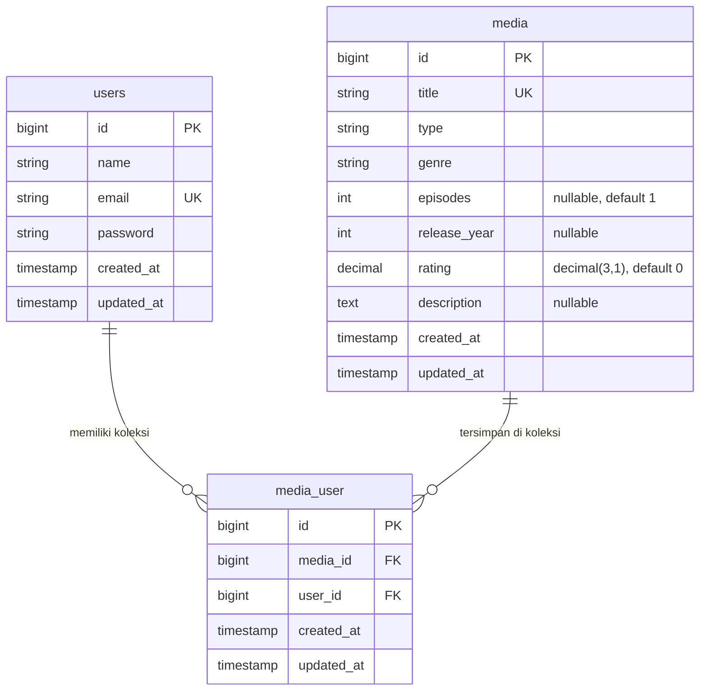

# FlipPlay REST API

Backend REST API murni untuk platform hiburan digital **FlipPlay** yang dibangun sebagai kelanjutan studi kasus OOP ke integrasi basis data relasional MySQL menggunakan **Laravel 12** (Pemrograman Web — Modul 4). API ini mengelola katalog media digital (anime, drama, movie, series) serta koleksi/library pribadi pengguna dengan relasi **Many-to-Many**.

## Teknologi yang Digunakan

- **PHP** `^8.2`
- **Laravel Framework** `^12.0`
- **Laravel Sanctum** `^4.0` (konfigurasi API routing via `php artisan install:api`)
- **MySQL** (database `flipplay_api`)
- **Eloquent ORM** (relasi Many-to-Many, Form Request Validation, API Resource)
- **PHPUnit** `^11.5.50` (Feature testing endpoint API)

---

## Skema & Relasi Database

Proyek ini menggunakan 3 tabel utama dengan relasi **Many-to-Many** antara `users` dan `media` melalui tabel pivot `media_user`.



### Detail Tabel & Relasi
1. **`users`** (`database/migrations/0001_01_01_000000_create_users_table.php`)
   - Tabel bawaan Laravel untuk data pengguna (`id`, `name`, `email`, `password`, `timestamps`).
   - Relasi di `App\Models\User`: `media()` menggunakan `belongsToMany(Media::class)->withTimestamps()`.
2. **`media`** (`database/migrations/2026_11_25_140000_create_media_table.php`)
   - Menyimpan katalog hiburan (`title` unik, `type`, `genre`, `episodes`, `release_year`, `rating`, `description`, `timestamps`).
   - Relasi di `App\Models\Media`: `users()` menggunakan `belongsToMany(User::class)->withTimestamps()`.
3. **`media_user`** (`database/migrations/2026_11_25_140001_create_media_user_table.php`)
   - Pivot table penghubung `media_id` dan `user_id` dengan `constrained()->cascadeOnDelete()` serta constraint `unique(['media_id', 'user_id'])`.

---

## Instalasi & Menjalankan Proyek

1. **Clone repository & masuk ke direktori proyek**
   ```bash
   git clone <url-repository>
   cd flipplay-api
   ```

2. **Install dependensi PHP**
   ```bash
   composer install
   ```

3. **Salin & konfigurasi file `.env`**
   ```bash
   cp .env.example .env
   ```
   Sesuaikan konfigurasi database MySQL pada `.env`:
   ```env
   DB_CONNECTION=mysql
   DB_HOST=127.0.0.1
   DB_PORT=3306
   DB_DATABASE=flipplay_api
   DB_USERNAME=root
   DB_PASSWORD=
   ```
   *(Pastikan database `flipplay_api` sudah dibuat di MySQL).*

4. **Generate Application Key**
   ```bash
   php artisan key:generate
   ```

5. **Jalankan Migration & Seeder**
   ```bash
   php artisan migrate:fresh --seed
   ```
   Perintah ini akan membuat seluruh tabel sekaligus mengisi **3 user dummy** dan **8 data media dummy** beserta contoh koleksi awalnya.

6. **Jalankan Server Lokal**
   ```bash
   php artisan serve
   ```
   Base URL API: `http://127.0.0.1:8000/api`

7. **Menjalankan Automated Test (Opsional)**
   ```bash
   php artisan test
   ```

---

## Dokumentasi Endpoint API

> **Catatan Header Request:** Saat menguji dari Postman atau HTTP client lain, selalu sertakan header `Accept: application/json` agar respons error validasi (`422`) maupun not found (`404`) dikembalikan dalam format JSON.

### 1. Daftar Endpoint

| Method | URL | Deskripsi | Request Body JSON / Query | Response Status Code |
| :--- | :--- | :--- | :--- | :--- |
| `GET` | `/api/media` | Menampilkan daftar media terpaginasi (10 item per halaman) | Query opsional: `?search=<judul>` | `200 OK` |
| `POST` | `/api/media` | Menambahkan media baru ke katalog | JSON field `title`, `type`, `genre` (wajib); `episodes`, `release_year`, `rating`, `description` (opsional) | `201 Created`, `422 Unprocessable Content` |
| `GET` | `/api/media/{media}` | Menampilkan detail 1 media beserta daftar `users` yang menyimpannya | `-` | `200 OK`, `404 Not Found` |
| `PUT` / `PATCH` | `/api/media/{media}` | Memperbarui data media (mendukung partial update dengan `sometimes`) | JSON field yang ingin diperbarui | `200 OK`, `404 Not Found`, `422 Unprocessable Content` |
| `DELETE` | `/api/media/{media}` | Menghapus media dari katalog | `-` | `200 OK`, `404 Not Found` |
| `GET` | `/api/users` | Menampilkan seluruh pengguna beserta koleksi `media` masing-masing | `-` | `200 OK` |
| `GET` | `/api/users/{user}` | Menampilkan detail 1 pengguna beserta koleksi `media`-nya | `-` | `200 OK`, `404 Not Found` |
| `POST` | `/api/users/{user}/collection` | Menambahkan media ke koleksi pengguna | `{"media_id": 1}` | `201 Created`, `404 Not Found`, `409 Conflict`, `422 Unprocessable Content` |
| `DELETE` | `/api/users/{user}/collection/{media}` | Menghapus media dari koleksi pengguna | `-` | `200 OK`, `404 Not Found` |

### 2. Contoh Request Body & Response

#### `POST /api/media`
**Request Body:**
```json
{
  "title": "Vinland Saga",
  "type": "anime",
  "genre": "Action, Historical",
  "episodes": 48,
  "release_year": 2019,
  "rating": 8.8,
  "description": "Kisah perjalanan Thorfinn mencari arti pejuang sejati."
}
```
**Response `201 Created`:**
```json
{
  "data": {
    "id": 9,
    "title": "Vinland Saga",
    "type": "anime",
    "genre": "Action, Historical",
    "episodes": 48,
    "release_year": 2019,
    "rating": 8.8,
    "description": "Kisah perjalanan Thorfinn mencari arti pejuang sejati."
  }
}
```

#### `GET /api/media/{media}`
**Response `200 OK`:**
```json
{
  "data": {
    "id": 1,
    "title": "Jujutsu Kaisen",
    "type": "anime",
    "genre": "Action, Dark Fantasy",
    "episodes": 47,
    "release_year": 2020,
    "rating": 8.7,
    "description": "Yuji Itadori bergabung dengan organisasi rahasia penyihir Jujutsu untuk membasmi kutukan setelah menelan jari Sukuna.",
    "users": [
      {
        "id": 1,
        "name": "Raka Pratama",
        "email": "raka@flipplay.test"
      }
    ]
  }
}
```

#### `DELETE /api/media/{media}`
**Response `200 OK`:**
```json
{
  "message": "Media berhasil dihapus"
}
```

#### `POST /api/users/{user}/collection`
**Request Body:**
```json
{
  "media_id": 2
}
```
- **Response `201 Created`:**
  ```json
  {
    "message": "Media berhasil ditambahkan ke koleksi"
  }
  ```
- **Response `409 Conflict`** *(jika media sudah ada di koleksi user)*:
  ```json
  {
    "message": "Media sudah ada di koleksi"
  }
  ```

#### `DELETE /api/users/{user}/collection/{media}`
- **Response `200 OK`:**
  ```json
  {
    "message": "Media berhasil dihapus dari koleksi"
  }
  ```
- **Response `404 Not Found`** *(jika media tidak ada di koleksi user)*:
  ```json
  {
    "message": "Media tidak ditemukan di koleksi pengguna"
  }
  ```
